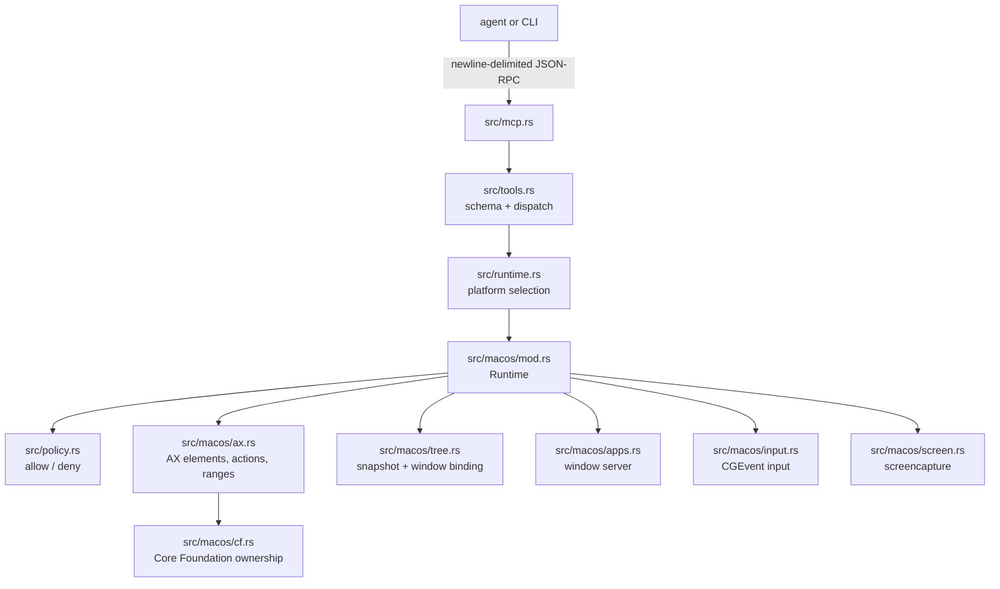
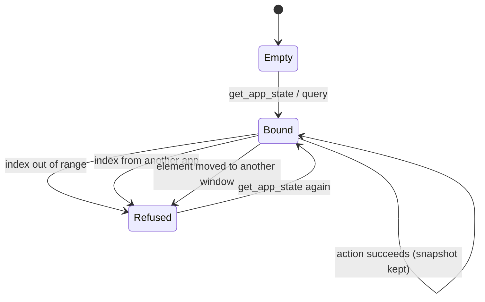

# Architecture

One process, one thread, one snapshot at a time. The server reads JSON-RPC
lines, resolves an app, checks policy and permissions, calls macOS, and writes a
result. There is no async runtime and no background work, so an agent's calls
always see the effects of its previous call.

## Modules

| Module | Responsibility | Unsafe |
| --- | --- | --- |
| `src/main.rs` | CLI: `mcp`, `call`, `tools`, `doctor`, `install`, `apps`. Parses arguments, prints MCP-shaped results, sets exit codes. | no |
| `src/mcp.rs` | stdio transport: read a line, answer one request, flush. Version negotiation, the method table, and the `computer-use://screen` resource with its subscription notifications. | no |
| `src/tools.rs` | The single tool list: schemas, annotations, dispatch to `Runtime`, and the `content`/`isError` shape. | no |
| `src/install.rs` | Writes each client's config: JSON via `serde_json`, Codex's TOML via `toml_edit` (round-trip, comments kept), atomic rename; refuses a name the client already uses. | no |
| `src/policy.rs` | Per-app approvals: the deny list, the allow list, bundle identities pinned to an approval, one-call approvals, the default policy. Re-reads the file on every call. | no |
| `src/runtime.rs` | Picks the backend. macOS is real; other platforms get a stub whose every method returns an error, so the tool list stays identical. | no |
| `src/verify.rs` | The `verify` command: exercises each native path the tools depend on and reports the evidence, so an unverifiable behaviour becomes one command | no |
| `src/macos/mod.rs` | `Runtime`: resolve app, guard permissions, snapshot, act, verify. | no |
| `src/macos/ax.rs` | `AXUIElement` wrapper: attributes, actions, settability, text ranges, trust. | yes |
| `src/macos/tree.rs` | Renders the tree, numbers it, binds each node to its `AXWindow`, truncates explicitly. | no |
| `src/macos/apps.rs` | `CGWindowListCopyWindowInfo` app and window enumeration, screen-recording preflight, and a process's bundle identity via `proc_pidpath` and `CFBundleGetIdentifier`. | yes |
| `src/macos/input.rs` | Pointer, keyboard and scroll events from a private HID event source, paced, and the text/key decoding a model's arguments need. | yes |
| `src/macos/takeover.rs` | A listen-only `CGEventTap` that separates a person's input from events this process posted, so a paced gesture can yield. | yes |
| `src/macos/screen.rs` | `screencapture` invocation, temp file handling, empty-image detection. | no |
| `src/macos/cf.rs` | Core Foundation ownership: `Owned` handles, string/number/boolean/data bridging. | yes |

## A tool call, end to end

1. **Transport** (`mcp.rs`) — a line on stdin is parsed as JSON. Malformed JSON
   produces a `-32700` response with `id: null`; a request without `id` is a
   notification and gets no answer.
2. **Dispatch** (`tools.rs`) — `tools/call` looks up the tool name and passes the
   arguments object to `Runtime`. An unknown name becomes an `isError` result,
   not a protocol error. A call that panics is answered the same way (`contained`
   in `mcp.rs`), so one broken call does not end the connection.
3. **Resolution** (`macos/mod.rs`) — `app` becomes a running app: pid, exact
   name, then case-insensitive substring over every window owner, helpers
   included.
4. **Policy** (`policy.rs`) — the app's real name is checked against the allow and
   deny lists. A denial is reported before permissions are examined, so "blocked"
   never looks like "not set up".
5. **Guard** (`ax::trusted`) — Accessibility must be granted to this process,
   otherwise the call fails with the Settings pane to approve. `list_apps` and
   `screenshot` do not need it.
6. **Observe** (`tree.rs`) — the app element (or one window element) is walked
   breadth-first through `AXChildren` up to the node and depth budget. Each node
   records its element handle, role, rendered line, on-screen center and owning
   `AXWindow`. A read an app never answers fails after the messaging timeout
   (`ax::MESSAGING_TIMEOUT_SECONDS`) instead of being read as an empty tree.
7. **Act** (`macos/mod.rs` → `ax` / `input`) — accessibility first; pointer
   events only where AX has no equivalent.
8. **Verify** — writes and selections are read back; actions that cannot be
   verified are not claimed as done.
9. **Reply** (`tools.rs`) — text first, then any image, with `isError` false; a
   failure returns the same shape with `isError` true.

## Snapshot and index lifecycle

The `Runtime` keeps a `Vec<Cached>` of retained elements plus the app name they
came from. `get_app_state` and `query` replace it; actions read it. Because it is
in-memory state, it lives exactly as long as the process:

- `oxide-computer-use mcp` — one snapshot for the whole connection, so an agent can read
  once and act several times.
- `oxide-computer-use call ...` — one process per command; a sequence in `--calls`
  shares one `Runtime`, which is why a read followed by an action works there.
- Two agents in two processes never share or corrupt each other's indexes.

## Why accessibility first

`AXPress` works on a background app and needs no pointer, so an agent can drive a
window that is covered by another app or in another Space. Pointer events are
only used when an element exposes no press action, and then the app is activated
first. `type_text` and `press_key` inevitably need the app in front; `set_value`
does not. Every reply says which path ran, because the side effects differ.

## Input pacing

A pointer event posted with no gap is frequently coalesced or dropped by the
window server, which is what makes "drag does nothing" bugs. The input layer
therefore:

- creates a private `CGEventSource` in the HID system state and zeroes the local
  event suppression interval;
- moves the pointer, waits 35 ms, presses, waits 35 ms, then posts sixteen drag
  steps 12 ms apart with per-step deltas, waits again, and releases;
- sets a monotonically increasing click state on repeated down/up pairs, so a
  double/triple-click consumer sees a real sequence rather than bare clicks.

Keyboard input uses key codes for named keys and a UTF-16 string per line for
`type_text`, which reaches the app's key handling instead of the pasteboard; a
newline in the text is pressed as `Return` because an app that receives one
inside a keyboard event usually inserts nothing.

A gesture also yields. `takeover.rs` installs a listen-only session event tap
before a drag or a multi-line type and reads it between steps. Every event this
runtime posts carries its own process id as the source, and a person's hardware
input does not, so one comparison in the tap callback separates the two. The
first keystroke, pointer movement or scroll from anyone else releases what is
held and fails the call with `user takeover`, rather than fighting the pointer.
A tap the window server refuses leaves the gesture without that arbitration, and
whether an installed tap receives a person's events is only proven on a granted
machine; `oxide-computer-use verify` reports both.

`type_text` and `press_key` take `background`, which aims the same events at one
process with `CGEventPostToPid` instead of the HID tap: the app is not activated
and the person keeps the keyboard focus. Nothing else about the events changes,
so an app that ignores posted-to-pid keys ignores them here too — which is why
the reply names the delivery path and asks for verification.

## Action settling

Every successful mutating call records an action timestamp. The next
`get_app_state` waits for the remaining part of a one-second settle window, then
reads the tree. If that tree still contains `AXProgressIndicator`, a busy marker,
or a loading value, the runtime polls the accessibility tree every 250 ms until
the state settles or five seconds have elapsed. The wait is bounded and belongs
to observation, so failed actions do not create delayed reads.

Selected apps also receive a short, independently authored
`<app_specific_instructions>` block on their first successful read. Guidance is
tracked per bundle identity in the runtime process and is never copied from
Codex's proprietary instruction corpus.

## Window binding

`tree.rs` threads the current `AXWindow` down the walk: when a node's role is
`AXWindow`, that node becomes the binding for its whole subtree. `macos/mod.rs`
stores the binding with each element, and before any indexed action walks up from
the element with `AXParent` until it reaches an `AXWindow` and compares identity
with `CFEqual`. Identity, not title: a renamed window stays valid, and a closed
one does not.

## MCP layer

- Framing: one JSON packet per line on stdout, flushed after each write. stdout
  carries protocol only; nothing else is printed, which keeps a client's parser
  safe. Diagnostics from the CLI go to stderr.
- Methods: `initialize`, `ping`, `tools/list`, `tools/call`, `resources/list`,
  `resources/read`, `resources/subscribe`, `resources/unsubscribe`. Notifications
  (`notifications/initialized`, `notifications/cancelled`) are accepted and not
  answered. Anything else returns `-32601`.
- Revisions: the server answers `2025-06-18`, `2025-03-26` and `2024-11-05`, and
  echoes whichever the client asked for when it is one of them; an unknown
  revision gets the newest. Echoing matters because clients reject a revision
  they did not request.
- Capabilities: tools (`listChanged: false`) and resources (`subscribe: true`).
  The one resource is `computer-use://screen`, a fresh capture; a subscriber is
  told after any call that could have changed it. No prompts or sampling are
  advertised, so a client never calls those methods.
- Approvals: the client decides. This server only supplies `readOnlyHint`,
  `destructiveHint` and `idempotentHint`, plus its own app policy.

## Memory and FFI ownership

All `unsafe` lives in `src/macos/`. Two handle types keep Core Foundation's
reference counting honest:

- `cf::Owned` wraps a `+1` reference and releases it on drop, with
  `from_create` for `Create`/`Copy` results and `from_get` for borrowed ones.
- `ax::Element` wraps an `AXUIElementRef` the same way, clones by retaining, and
  releases on drop. Snapshots hold retained elements, so a tree stays valid while
  an agent reads and acts.

Attribute values are typed before use: string, number, boolean, array of
elements, or an `AXValue` decoded as `CGPoint`, `CGSize` or `CFRange`. A miss is
`None`, never a reinterpreted pointer.

## Platform contract

`src/runtime.rs` defines the shape a backend must provide: `list_apps`,
`get_app_state`, `query`, `click`, `perform_action`, `set_value`, `select_text`,
`type_text`, `press_key`, `scroll`, `drag`, `paste`, `screenshot` and `guard`,
plus a shared `State { text, image }`. A backend that cannot implement a tool
must return an error; the non-macOS stub does exactly that, so a Windows or Linux
build fails loudly instead of pretending.

## What this design deliberately does not do

- No script evaluation, so no JavaScript or AppleScript escape hatch.
- No network access, no telemetry, no image analysis or OCR.
- No background watchers: nothing happens between calls.
- No concurrency: a long AX call blocks the next request, which keeps index
  semantics simple and predictable. A call that never returns at all is bounded
  instead of blocking forever: one accessibility message waits two seconds for
  the app, then the call fails and reports why.
- No UI: `doctor`, `--prompt` and the config files are the whole surface.
